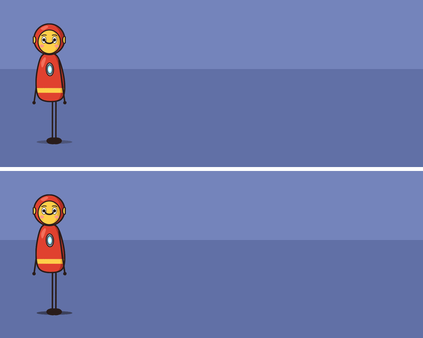
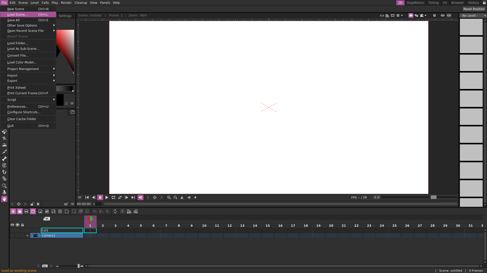
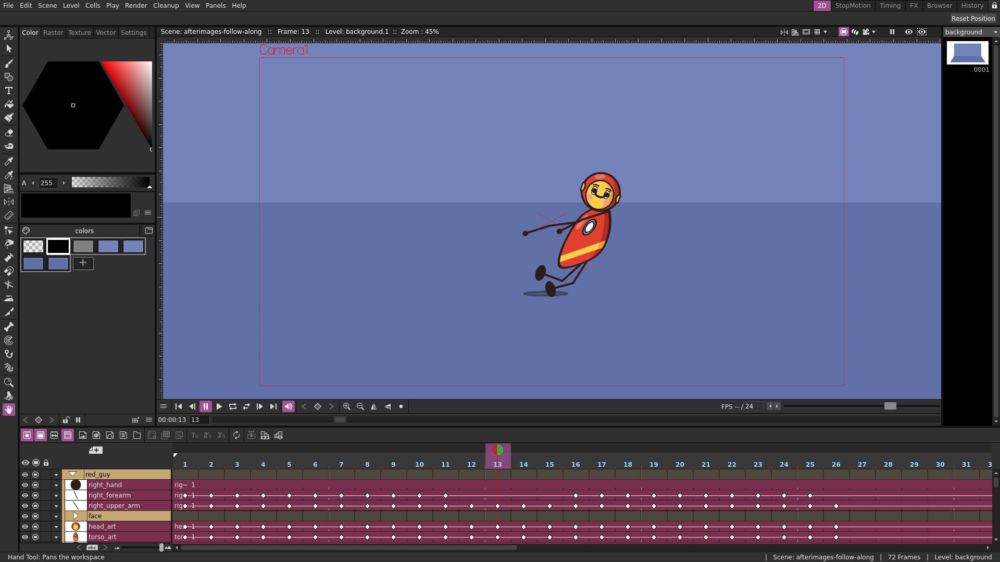
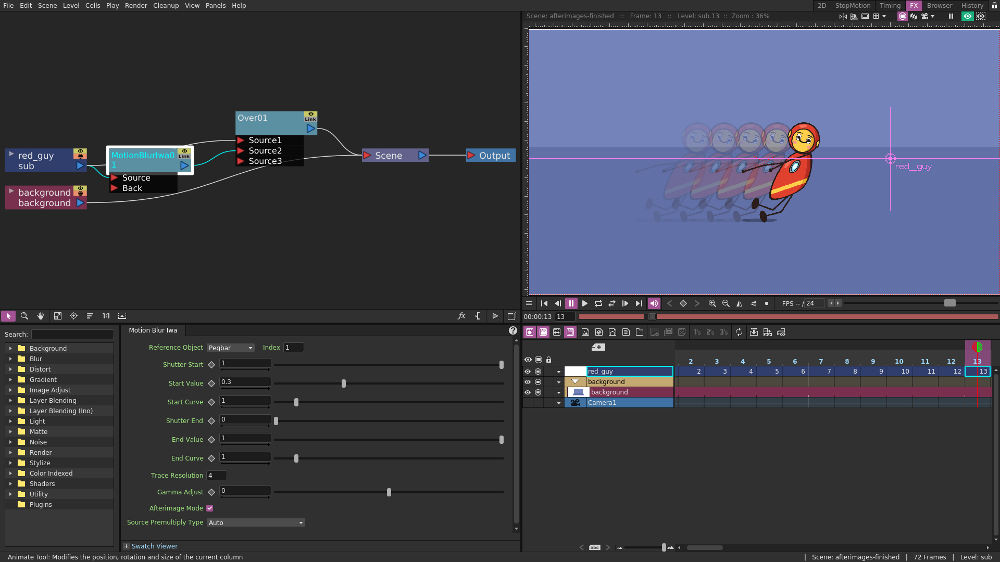
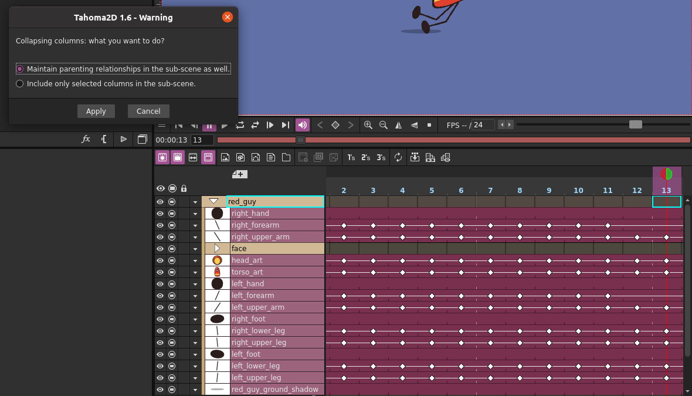
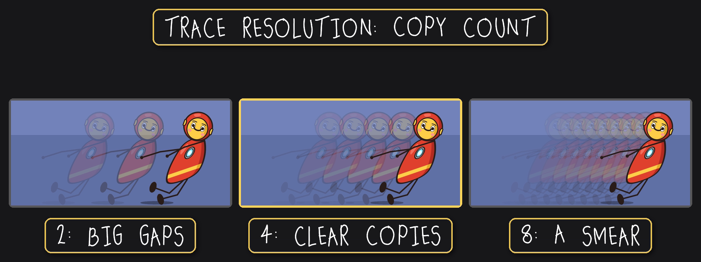
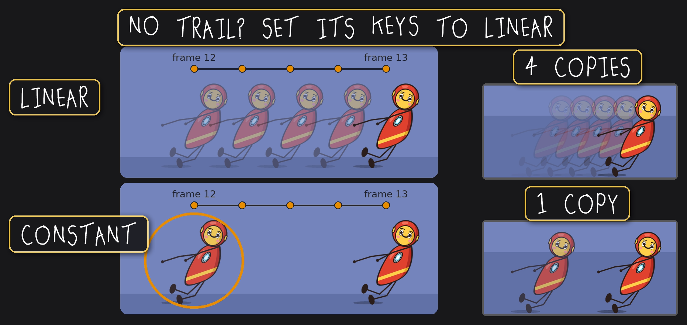
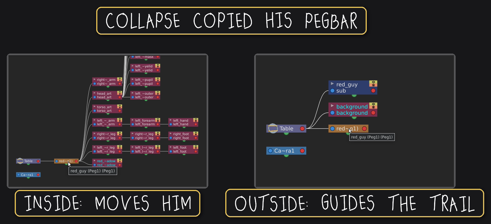

# 01 · Afterimages

The project from episode 1 of the Anjero Animations Tahoma2D tutorials. Red Guy glides
across, and fading copies trail behind him (above: without, then with). It's one stock
effect, Motion Blur Iwa, so you can add it to your own characters.

Made and tested in Tahoma2D 1.6.3.

## What's in it

| File or folder | What it is |
| --- | --- |
| `scenes/afterimages-follow-along.tnz` | Where the video starts: Red Guy dashing, no effect yet. Open this one to build it yourself as you watch. |
| `scenes/afterimages-finished.tnz` | What the video builds, with the effect set up. |
| `drawings/` | Red Guy's parts (`red_guy_…`) and the background, as vector drawings. |
| `tahomaproject.xml` | Makes the folder a Tahoma project, so the scenes find their drawings. |
| `extras/`, `inputs/`, `outputs/`, `palettes/`, `scripts/`, `stopmotion/` | The folders every Tahoma project has. They start empty; renders go in `outputs/`. |

## Open it

In Tahoma2D, choose **File > Load Scene** and open either scene from the `scenes` folder.

## The follow-along scene

Red Guy is a folder of parts in the timeline, each part keyed to pose him. His
`red_guy` pegbar carries him across.

## The finished scene

Red Guy is collapsed into one column, so the effect touches only him. His column feeds
an **Over** twice: straight into Source1, a solid Red Guy on top, and through **Motion
Blur Iwa** into Source2, the copies underneath. On its own, the effect blends Red Guy
with his copies, so he'd be see-through; the Over puts him back on top, solid.

When you collapse him yourself (right-click his folder, **Collapse**), choose **Maintain
parenting relationships**, so his parts keep moving with his pegbar.

Motion Blur Iwa's settings:

| Setting | Value | Why |
| --- | --- | --- |
| Reference Object | Pegbar, Index 1 | Red Guy's column never moves; his pegbar does. |
| Shutter Start | 1 | Looks back a whole frame of travel. |
| Shutter End | 0 | Keeps the trail behind him. |
| Afterimage Mode | On | Separate copies instead of a blur. |
| Trace Resolution | 4 | Four copies, clear and separate at his speed. |
| Start Value | 0.3 | The oldest copy is faint, so the trail fades away behind him. |

Everything else is left as it comes.

## Tips

**No trail on your own character?** The effect checks where it is between frames, so its
keys need to be Linear. With Constant keys it holds still, then jumps, and every check
finds it in the same place.

**Changing his path later?** Collapse copied his `red_guy` pegbar. The copy inside his
column moves him; the one left in the main scene, Pegbar 1, only guides the trail.
Change one and the trail stops matching him. Exploding him back won't fix it: the
effect survives, but his path moves to a new pegbar. So finish his movement first, and
add the effect last.

## Licence

Copyright © 2026 Anjero Animations. Licensed under
[Creative Commons Attribution-NonCommercial 4.0](https://creativecommons.org/licenses/by-nc/4.0/)
(CC BY-NC 4.0); the full text is in `LICENSE`. Learn from it, teach with it, change it
and share it, crediting Anjero Animations. Don't sell it or use Red Guy in commercial
work. The technique is yours to use anywhere.
